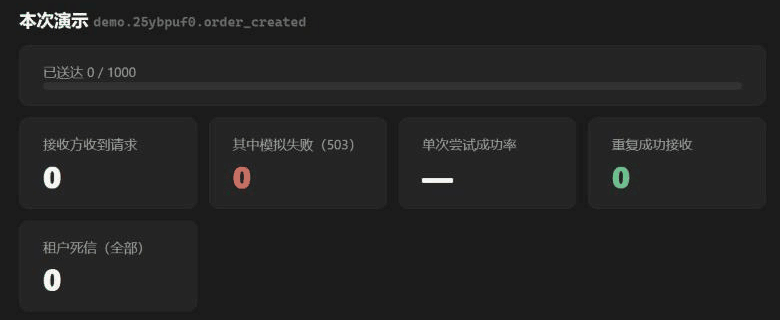
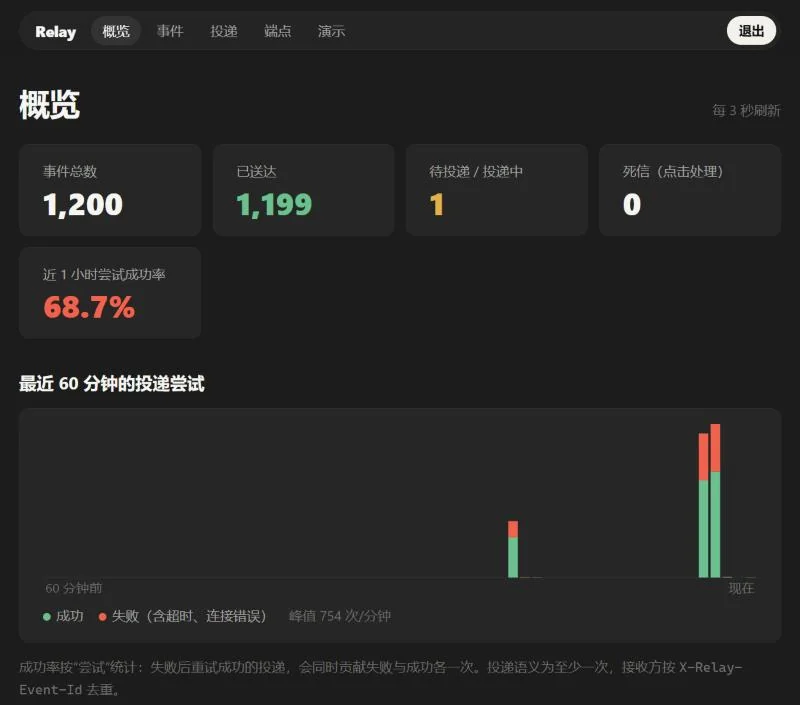
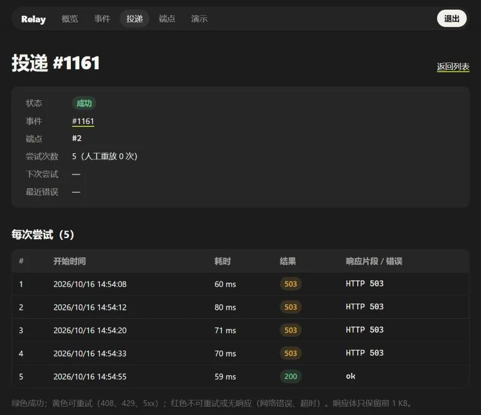
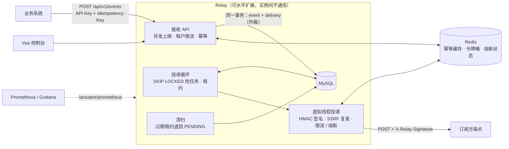
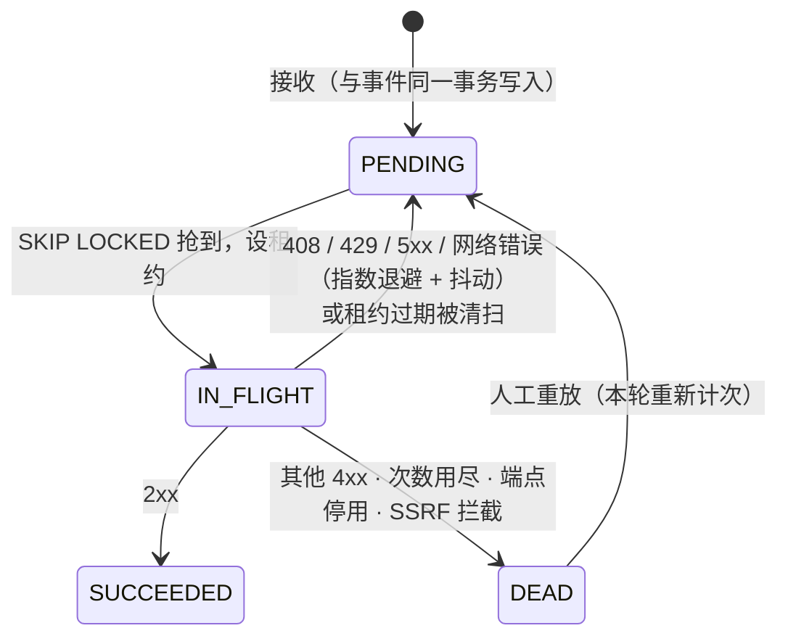

# Relay · Webhook 可靠投递平台

业务系统把事件交给 Relay，Relay 负责把它**可靠地**推送到订阅方的 HTTP 地址：不丢、不重复接收、可重试、可追踪、可限流、签名防伪。

Java 21 · Spring Boot 4.1 · MySQL 8.4 · MyBatis · Flyway · Redis 7 · Vue 3 · Testcontainers · Micrometer / Prometheus / Grafana · Docker Compose · GitHub Actions · k6

一键演示：1000 个事件发往 30% 失败率的接收方，失败的按退避重试，最终全部送达且没有重复接收：



| 概览 | 一次投递的每次尝试（4 次 503 后成功，间隔按指数退避增长） |
| --- | --- |
|  |  |

## 一键启动

只需要 Docker（含 Compose v2）、`openssl` 与 `curl`：

```bash
git clone https://github.com/Asami233/webhook-relay.git && cd webhook-relay
./scripts/quickstart.sh
```

脚本会生成带随机口令的 `.env`、从源码构建镜像并启动 MySQL / Redis / Relay，然后创建一个演示租户，打印控制台地址 <http://localhost:8080/console/> 与 API Key。进入控制台点“演示”，一键把 1000 个事件发到 30% 失败率的模拟接收方，实时看重试、死信和送达率。

本地开发（JDK 21 + Node 22）：

```bash
cp .env.example .env              # 填入随机口令；RELAY_MASTER_KEY 用 openssl rand -base64 32
docker compose up -d --wait       # 只起 MySQL(127.0.0.1:13306) + Redis(127.0.0.1:16379)
./mvnw spring-boot:run            # http://localhost:8080，Flyway 自动建表
cd console && npm ci && npm run dev   # 控制台开发模式 http://localhost:5173/console/
./mvnw verify                     # 93 项测试，Testcontainers 拉起真实 MySQL / Redis
```

## 架构



投递状态机（每次尝试都记录在 `delivery_attempt`）：



## 设计要点

**可靠性**
- **事务外箱**：`event` 与按订阅扇出的 `delivery` 在同一事务写入，返回 202 即代表投递任务已持久化；刻意不用 MQ（1 核 1G 资源下少一个组件少一类故障，升级路径是外箱 + CDC/转发器）。
- **抢任务**：`SELECT … FOR UPDATE SKIP LOCKED` 与改为 `IN_FLIGHT`、设租约在同一短事务；提交后才发 HTTP，网络请求不占行锁和连接。
- **租约与 fencing**：实例崩溃后租约过期，清扫退回 `PENDING`；回写结果以 `attempts` 为条件，旧实例的迟到结果不会覆盖新一轮投递。
- **至少一次**：请求带 `X-Relay-Event-Id`、`X-Relay-Delivery-Id`、`X-Relay-Attempt`，接收方按事件 ID 去重；“恰好一次”在网络两端不可得。
- **优雅停机**：先停抢任务，等在途投递写回结果；超时未完成的靠租约过期兜底。

**幂等、限流与过载**
- **幂等**：`UNIQUE(tenant_id, idempotency_key)` 兜底，并发同键只有一个插入成功，其余读回已提交结果；同键不同内容返回 422。Redis 只做提交后的快速路径缓存。
- **限流**：Redis + Lua 令牌桶（时间取 Redis `TIME`，多实例共享）。接收侧按租户，超限 429 + `Retry-After`；投递侧按端点，等待 ≤ 1 秒时**预约令牌**原地等，超出则带抖动退回队列，都不计尝试次数。Redis 故障时放行。
- **过载保护**：接收并发上限（默认 64），超出立即 503 + `Retry-After`，避免排队撑满堆、GC 停顿拉长连接占用而雪崩。
- **熔断**：端点连续可重试失败达阈值后暂停 60 秒，冷却后再失败一次立即重开。

**安全**
- **签名**：`X-Relay-Signature: t=<秒>,v1=<HMAC-SHA256(secret, "t.原始请求体")>`，接收方校验 5 分钟时间窗防重放。
- **SSRF**：登记时与每次投递前按**解析后的 IP** 判断，拒绝环回、私网、链路本地（含云元数据）、CGNAT、组播、IPv6 ULA 及其 IPv4 嵌入写法；不跟随重定向。已知局限：检查与建连之间的 DNS rebinding 窗口。
- **密钥**：API Key 为 256 位随机数，只存 SHA-256；端点 secret 用 AES-256-GCM 加密存储（签名要用明文）；控制台严格 CSP。
- **租户隔离**：所有查询带 `tenant_id`，跨租户一律 404。

**性能**（1 核容器，详见 [docs/BENCHMARK.md](docs/BENCHMARK.md)）：接收 600 次/秒 P99 48 ms；过载时超出部分立即 503 而不雪崩；投递侧限流退回 14 970 次 → 0；应用内存约 300 MiB（`-Xmx128m` Serial）。

## API 速览

所有接口用 `Authorization: Bearer <token>`；错误统一为 RFC 9457 ProblemDetail，`code` 为机器可读类别。

| 方法 | 路径 | 鉴权 | 说明 |
| --- | --- | --- | --- |
| POST | `/api/admin/tenants` | 管理口令 | 创建租户，**API Key 明文只返回这一次** |
| GET | `/api/admin/tenants` | 管理口令 | 租户列表 |
| POST | `/api/admin/tenants/{id}/rotate-key` | 管理口令 | 轮换 API Key（旧 Key 在本实例立即失效） |
| POST | `/api/v1/endpoints` | API Key | 登记端点；`eventTypes` 支持 `*`、`order.*`、精确类型；返回签名 secret（只此一次） |
| GET / PATCH / DELETE | `/api/v1/endpoints/{id}` | API Key | 查看 / 部分更新 / 软删除 |
| POST | `/api/v1/endpoints/{id}/rotate-secret` | API Key | 轮换签名 secret |
| POST | `/api/v1/events` | API Key + `Idempotency-Key` | 接收事件，202；重复键返回首次结果并带 `Idempotent-Replayed: true`；同键不同内容 422；超限 429；过载 503 |
| GET | `/api/v1/events?before=&limit=` | API Key | 事件列表（键集分页） |
| GET | `/api/v1/events/{id}` | API Key | 事件详情与各端点投递状态 |
| GET | `/api/v1/deliveries?status=&before=&limit=` | API Key | 投递列表（如 `status=DEAD` 查死信） |
| GET | `/api/v1/deliveries/{id}` | API Key | 投递详情与每次尝试（状态码、耗时、错误、响应前 1 KB） |
| POST | `/api/v1/deliveries/{id}/replay` | API Key | 死信重放：本轮重新获得 `maxAttempts` 次机会，尝试历史保留 |
| POST | `/api/v1/endpoints/{id}/replay-dead` | API Key | 批量重放该端点全部死信 |
| GET | `/api/v1/stats` | API Key | 概览：按状态的投递数、最近 60 分钟每分钟成功/失败尝试 |
| POST | `/api/v1/demo` | API Key | 一键演示（需 `RELAY_SINK_ENABLED=true`） |
| POST / GET / PUT / DELETE | `/api/v1/sinks[/{id}[/config]]` | API Key | 模拟接收方：失败率、失败状态码、延迟；统计重复投递 |

```bash
curl -X POST localhost:8080/api/v1/events \
  -H "Authorization: Bearer $API_KEY" -H "Idempotency-Key: order-1001-created" \
  -H "Content-Type: application/json" \
  -d '{"type":"order.created","payload":{"orderId":1001}}'
# 202 {"eventId":1,"deliveries":1}
```

## 接收方：校验签名

1. 用**原始请求体字节**计算 HMAC，不要先解析 JSON 再序列化；
2. 拒绝时间戳与当前时间相差超过 5 分钟的请求；
3. 常量时间比较；`v1` 可能有多个（为 secret 轮换预留），任一匹配即通过；
4. 投递是至少一次：校验通过后按 `X-Relay-Event-Id` 去重再处理。

- Java：[`WebhookSignature.verify(...)`](src/main/java/party/huantongxue/relay/signature/WebhookSignature.java)（无 Spring 依赖，可直接复制）
- Python：[`examples/verify_signature.py`](examples/verify_signature.py)（仅标准库；两种实现用同一组测试向量互相校验）

## 可观测性

- `GET /actuator/prometheus`：`relay_delivery_total{result}`、`relay_delivery_latency_seconds`（事件创建 → 成功送达）、`relay_delivery_attempt_seconds{outcome}`、`relay_backlog`、`relay_oldest_pending_seconds`、`relay_deliveries{status}`、`relay_delivery_deferred_total{reason}`、`relay_ingest_total{result}`。标签只用低基数类别。
- `/actuator/health/liveness`、`/actuator/health/readiness`（就绪要求数据库可用；Redis 故障时 fail-open，不影响就绪）。
- 投递日志带 `[delivery=… event=…]`。
- 本地面板：`docker compose --profile monitoring up -d`，Grafana <http://127.0.0.1:3000>（预置 14 个面板），Prometheus <http://127.0.0.1:9091>。

## 文档

- [docs/BENCHMARK.md](docs/BENCHMARK.md)：压测方法、每一步调优的数据、部署内存预算
- [docs/INTERVIEW.md](docs/INTERVIEW.md)：常见面试问题 → 本项目里的答案与代码位置
- [docs/PLAN.md](docs/PLAN.md) / [docs/PROGRESS.md](docs/PROGRESS.md)：7 天计划与每天的验收记录

## 不做的事（取舍）

- 不引入 Kafka / RabbitMQ：见“事务外箱”；
- 不上线公网演示：全套（应用 + MySQL + Redis）实测约 400–550 MiB，超出目标 VPS 的余量（见 BENCHMARK.md），以一键启动代替；
- 不追求“恰好一次”：由接收方按事件 ID 去重。
